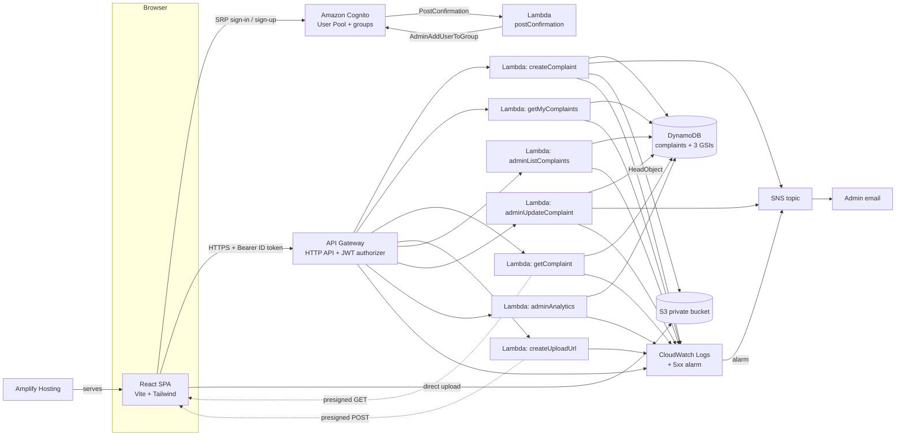

# Architecture

## 1. Overview



| Layer | Service | Role in CampusCare |
|---|---|---|
| Hosting | AWS Amplify Hosting | Builds the React app from GitHub and serves it over HTTPS/CDN |
| Identity | Amazon Cognito User Pool | Registration, email verification, SRP login, refresh tokens, `Students`/`Admins` groups |
| API | API Gateway HTTP API | Routes, CORS, throttling (10 rps / 20 burst), JWT validation before any Lambda runs |
| Compute | AWS Lambda (Node.js 22, arm64, 256 MB) | One small function per operation |
| Data | Amazon DynamoDB | Complaint records, status history, statistics counters |
| Files | Amazon S3 | Private complaint images |
| Notifications | Amazon SNS | Email to administrators on new/updated complaints and on API errors |
| Monitoring | Amazon CloudWatch | Structured JSON Lambda logs, API access logs, 5xx alarm, retention 14 days |
| Security | AWS IAM | One least-privilege role per function |
| IaC | AWS SAM / CloudFormation | Everything above in `template.yaml` (except Amplify, connected via console) |

## 2. Why serverless fits this problem

- **Spiky, unpredictable traffic.** Complaints spike after a power cut or Wi-Fi outage and are near zero at night or in vacations. Lambda and API Gateway scale per request and cost nothing while idle, whereas a server would be paid for 24×7.
- **Independent operations.** Each endpoint is its own function with its own permissions, logs and scaling. A bug or a burst in analytics cannot exhaust capacity for complaint submission.
- **File uploads without servers.** Presigned URLs send image bytes straight from the browser to S3, so Lambda never streams large payloads. That keeps functions small, fast and cheap.
- **Event-driven processing.** Cognito triggers a Lambda function on sign-up. Complaint events publish to SNS, and a CloudWatch alarm publishes to SNS when the API errors. Components react to events instead of polling.
- **No operations burden.** There's no OS patching, capacity planning or load balancer, which suits a college IT team.

## 3. Request flows

### 3.1 Student registration
1. The SPA calls Cognito `SignUp` (email, name, password). Cognito checks the password policy and emails a 6-digit code.
2. `ConfirmSignUp` verifies the email. The **PostConfirmation** Lambda adds the user to the `Students` group.
3. `SignIn` uses SRP, so the password never leaves the browser in plain form. Cognito returns ID, access and refresh tokens, and Amplify refreshes them automatically.

Administrators are **never** created through sign-up. An operator runs `scripts/create-admin.*`, which calls `AdminCreateUser`, sets a permanent password and adds the user to `Admins`.

### 3.2 Submitting a complaint with an image
```
Browser                       API GW + Lambda                    S3            DynamoDB      SNS
  │ POST /uploads/presign  ───►│ validate type+size                │               │            │
  │                            │ key = uploads/<sub>/<uuid>.png    │               │            │
  │◄── {url, fields, key} ─────│ createPresignedPost (5 min)       │               │            │
  │ POST multipart (fields+file) ─────────────────────────────────►│ enforce size  │            │
  │◄────────────────────────────────────────────────── 204 ────────│ & Content-Type│            │
  │ POST /complaints {…, attachmentKey} ─►│ key under caller prefix?│               │            │
  │                            │ HeadObject (exists, type, size) ─►│               │            │
  │                            │ TransactWrite: Put complaint + ADD counters ─────►│            │
  │                            │ Publish "New complaint" ──────────────────────────────────────►│ email
  │◄── 201 {complaint} ────────│                                   │               │            │
```

### 3.3 Admin status update
1. `PATCH /admin/complaints/{id}` with, for example, `{status: "IN_PROGRESS", adminRemarks: "Technician assigned"}`.
2. Lambda checks that the caller is in the `Admins` group, loads the current item and validates the transition against the workflow table.
3. A DynamoDB transaction updates the complaint with the condition `status = <previous status>` (optimistic locking), appends a timeline entry and adjusts the counters.
4. SNS emails the administrators. The student sees the new status, timeline and remarks on their next dashboard refresh: there's a 60-second auto-refresh while the tab is visible, plus a refresh on window focus, and an "Updated" badge and toast for unseen changes. None of this depends on email delivery.

### 3.4 Viewing an image
`GET /complaints/{id}` returns `attachmentUrl`, a presigned GET valid for **5 minutes** and only issued to the owner or an admin. If the link expires while the page is open, the UI fetches a fresh one once.

## 4. DynamoDB design

Table `campuscare-complaints-<stage>` has partition key `complaintId` (UUID v4).

| Attribute | Example | Notes |
|---|---|---|
| complaintId | `3f25…` | PK, `crypto.randomUUID()` |
| entityType | `COMPLAINT` | constant; GSI key for "all complaints" (sparse) |
| studentId | Cognito `sub` | from JWT only |
| studentName / studentEmail | | from JWT claims |
| title, description, location | | validated & sanitised |
| category | `WIFI` | enum |
| department | `IT_SERVICES` | enum, default from category |
| status | `PENDING` | enum |
| attachmentKey | `uploads/<sub>/<uuid>.jpg` | optional |
| adminRemarks, assignedTo | | admin-only writes |
| statusHistory | `[{status, at, by, note}]` | timeline |
| createdAt, updatedAt, lastStatusChangeAt, resolvedAt | ISO 8601 UTC | |

### Access patterns → indexes (no table scans anywhere)

| # | Access pattern | Implementation |
|---|---|---|
| 1 | Get one complaint | `GetItem` on `complaintId` |
| 2 | A student's complaints, newest first | **StudentIndex** `studentId` + `createdAt`, `Query` descending |
| 3 | All complaints, newest first (admin) | **CreatedAtIndex** `entityType` + `createdAt`, `Query` descending |
| 4 | Complaints by status, newest first (admin filter) | **StatusIndex** `status` + `createdAt`, `Query` descending |
| 5 | Filter by category/department | `FilterExpression` on query #3 or #4 |
| 6 | Dashboard totals by status/category/department | One **counter item** (`complaintId = "__STATS__"`) maintained with atomic `ADD` in the same transaction as every write, so `GetItem` is O(1) |
| 7 | Daily trend for the last N days | `Query` CreatedAtIndex with `createdAt >= since` (bounded range) |

Design notes:
- The stats item has no `entityType`, `studentId` or `status`, so it never appears in any GSI. It isn't a UUID, so `GET /complaints/__STATS__` is rejected with 400.
- `CreatedAtIndex` uses a single partition value. That's fine at campus scale (well below DynamoDB's per-partition limits). At much larger scale you would shard it (e.g. `COMPLAINT#2026-11`).
- Category is a filter rather than a fourth index. That keeps the total provisioned capacity at 20 RCU/20 WCU, inside the always-free 25/25.
- Pagination returns an opaque `nextToken`. The server checks that the token's partition matches the caller, so a crafted token can't read another student's partition.

## 5. Security model

| Threat | Control |
|---|---|
| Unauthenticated access | HTTP API JWT authorizer validates signature, issuer, audience (app client ID) and expiry before Lambda runs, returning 401 |
| Privilege escalation (student → admin) | Role comes only from the `cognito:groups` claim in the signed token. Admin Lambdas call `requireAdmin` (403). Groups can only be changed with AWS credentials |
| IDOR (reading others' complaints) | `getComplaint` compares `item.studentId` with the token `sub` and returns 404 for non-owners. `mine` queries by the token `sub` only |
| Forged identity fields in the body | `studentId`, `studentEmail`, `status` etc. in the request body are ignored |
| Malicious uploads | S3 presigned POST enforces `content-length-range` and exact `Content-Type`. Only JPEG/PNG/WebP are allowed. Keys are server-generated UUIDs. The backend checks the key prefix and runs `HeadObject` |
| Public data exposure | Block Public Access (all four flags), bucket-owner-enforced ownership, SSE-S3, TLS-only bucket policy, 5-minute GET links |
| Leaked credentials | No AWS keys in the SPA. The public client has no secret. Config files with deployment settings are git-ignored |
| Abuse / runaway cost | API throttling (10 rps, burst 20), request-body cap (16 KB), field length limits, 2 MB images, log retention 14 days |
| Concurrent admin edits | Conditional update on the previous status returns 409 Conflict |
| Account enumeration | `PreventUserExistenceErrors: ENABLED` |
| Weak passwords | Cognito policy: 8+ characters with upper, lower, number and symbol |

IAM is least privilege per function:

| Function | Allowed actions |
|---|---|
| createComplaint | `dynamodb:PutItem`, `dynamodb:UpdateItem` (table), `s3:GetObject` (`uploads/*`), `sns:Publish` (topic) |
| getMyComplaints | `dynamodb:Query` on `index/StudentIndex` only |
| getComplaint | `dynamodb:GetItem`, `s3:GetObject` (`uploads/*`) |
| createUploadUrl | `s3:PutObject` (`uploads/*`) |
| adminListComplaints | `dynamodb:Query` on `StatusIndex` and `CreatedAtIndex` |
| adminUpdateComplaint | `dynamodb:GetItem`, `dynamodb:UpdateItem`, `sns:Publish` |
| adminAnalytics | `dynamodb:GetItem`, `dynamodb:Query` on `CreatedAtIndex` |
| postConfirmation | `cognito-idp:AdminAddUserToGroup` on this account/region's user pools |

The postConfirmation policy uses `userpool/*` because referencing the pool's ARN would create a circular CloudFormation dependency: the pool references the function as its trigger.

## 6. Monitoring

- **Lambda logs:** every function writes one JSON line per request (`level`, `msg`, `requestId`, `statusCode`, `ms`). Example CloudWatch Logs Insights query:
  ```
  fields @timestamp, level, msg, statusCode, ms
  | filter level in ["warn","error"]
  | sort @timestamp desc
  ```
- **API access logs:** `/campuscare/<stage>/api-access` records method, path, status, latency, and authorizer and integration errors.
- **Alarm:** `campuscare-<stage>-api-5xx` fires on one or more 5xx responses in 5 minutes and notifies the SNS topic.
- **Retention:** 14 days, configurable, so logs don't accumulate cost.

## 7. Deliberate non-choices

| Not used | Why |
|---|---|
| EC2 / RDS / NAT Gateway / VPC | Not needed. They would add fixed hourly cost and patching work |
| EventBridge | The single event source (complaint created/updated) has one consumer (SNS). EventBridge would add a hop with no extra function |
| S3 event notifications | The upload is verified synchronously in `createComplaint` with `HeadObject`, which is simpler and immediately consistent |
| SMS | Costs money per message. Email is enough for the MVP |
| X-Ray, KMS customer keys, PITR | Useful in production but add cost. They can be enabled later in `template.yaml` |
